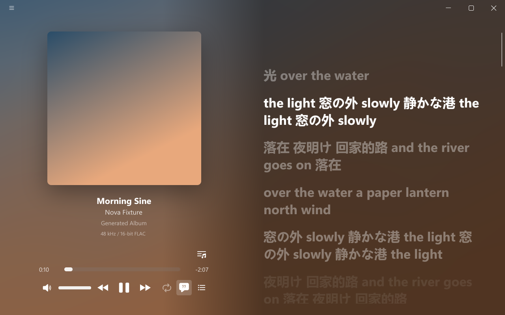

<h1 align="center">NovaPlayer</h1>

<p align="center">A music player for Windows and Linux, written in Rust.</p>

<p align="center">
  <a href="https://github.com/wuuuming/NovaPlayer/releases/latest"></a>
  <a href="#license"></a>
  
</p>

<p align="center">English | <a href="README.zh-CN.md">简体中文</a></p>

<p align="center"></p>

NovaPlayer plays the music files you already have and shows their lyrics in time next to the
cover. That's most of it. There's no library to import, no account and nothing running in the
background.

The idea is a player that opens at once, uses no CPU while nothing on screen moves, sounds right
through an ASIO interface, and looks at home on Windows 11, without a browser engine underneath.
It draws its window with [NovaUI](https://github.com/wuuuming/NovaUI) and plays through
[Player-Core](https://github.com/wuuuming/Player-Core), both written for it.

This is the first public release (0.0.1), so expect rough edges, and please
[open an issue](https://github.com/wuuuming/NovaPlayer/issues) when you hit one.

## What it does

- Plays FLAC, MP3, AAC / M4A, Ogg Vorbis, Opus and WAV, and APE, WavPack, TTA and TAK through CUE
  sheets (single-file albums too). Drop files or folders on the window, or open an M3U or CUE.
- Plays albums gaplessly. Crossfade (1 to 12 seconds) is there if you turn it on; a song you skip
  to by hand never crossfades.
- Shows lyrics from the file's tags or a `.lrc` next to it, scrolling with the song. Click a line
  to jump to it.
- Outputs through WASAPI or ASIO on Windows (DSD natively or as DoP over ASIO), and PulseAudio or
  PipeWire on Linux. ReplayGain by track or album, and CLAP effect plug-ins.
- Keeps your playlists and queue, and picks up where you stopped, paused.
- Takes online sources from plugins. Each plugin is its own process and can add sign-in, playlists to
  import, lyric translations and controls; the player itself knows nothing about any particular service.
  How to write one: [docs/plugins.md](docs/plugins.md).
- Speaks English and Simplified Chinese. Keyboard navigation and screen readers (Narrator, NVDA,
  Orca) can be turned on in Settings.

Not there yet: browsing a library by album or artist (for now it's playlists and a queue), tag
editing, media keys and the system's media controls, a mini player, and macOS. Issues and pull
requests for any of them are welcome.

## Download

Get the zip for your system from [Releases](https://github.com/wuuuming/NovaPlayer/releases/latest),
extract it anywhere and start it. Nothing gets installed.

- **Windows 10 or 11** (x64): run `Launch.cmd`. FFmpeg and the fonts are included.
- **Linux** (x86-64, glibc 2.35 or newer, e.g. Ubuntu 22.04 or Debian 12): run `./NovaPlayer.sh`.
  You need `ffmpeg` and `ffprobe`, PulseAudio or PipeWire, and a Vulkan driver (without one, start
  it with `--backend sw`).

Started that way, your playlists, settings and plugin sign-ins live in a `Data` folder next to the
program, so the whole thing can sit on a USB stick. Run `novaplayer` directly and it uses
`%LOCALAPPDATA%\NovaPlayer` or `~/.local/share/NovaPlayer` instead.

## Getting around

Add music with the buttons in the empty queue, by dragging it onto the window, or from the menu
next to the playlist's name. Settings are at the bottom of the ☰ menu. Right-click a song for its
menu, and right-click the volume button to pick the output device.

| Key | |
|---|---|
| Space | play / pause |
| ← → | seek 5 s |
| ↑ ↓ | volume |
| M | mute |
| L | lyrics |
| Q, Tab | show or hide the side panel |
| F, F11 | full screen |

## Building it yourself

You need Rust (on Windows with the MSVC build tools rustup asks for, and LLVM for the ASIO
bindings). Then:

```sh
git clone https://github.com/wuuuming/NovaPlayer.git
cd NovaPlayer
cargo build --release
```

The first build downloads what isn't in the repository, each pinned by checksum: FFmpeg (Windows)
and the Noto fonts. The program is `target/release/novaplayer`. On Linux it needs `ffmpeg`,
`ffprobe` and PulseAudio or PipeWire at run time.

## Contributing

Bug reports are the most useful thing right now. If you want to send code, read
[CONTRIBUTING.md](CONTRIBUTING.md) first; it says which of the three repositories a change belongs
in. How the app behaves is written down in [the spec](docs/novaplayer-spec.md), and
[the map](docs/map.md) says where everything is.

## Thanks

[FFmpeg](https://ffmpeg.org/) does the decoding, [cpal](https://github.com/RustAudio/cpal) the
ASIO, [Taffy](https://github.com/DioxusLabs/taffy) the layout, [HarfRust](https://github.com/harfbuzz/harfrust)
the text shaping and [AccessKit](https://github.com/AccessKit/accesskit) the screen readers. The
icons are Microsoft's [Fluent UI System Icons](https://github.com/microsoft/fluentui-system-icons),
the text is set in [Noto](https://fonts.google.com/noto), the controls follow
[WinUI](https://github.com/microsoft/microsoft-ui-xaml), and search finds songs by the readings of the
[Unicode Han Database](https://www.unicode.org/reports/tr38/).

## Disclaimer

NovaPlayer isn't affiliated with any music service. Whatever a plugin brings in (songs, lyrics,
artwork) belongs to its rights holders. Use plugins only as the service's terms allow, and support
artists through official channels.

## License

The code is yours under [Apache-2.0](LICENSE-APACHE) or [MIT](LICENSE-MIT), whichever you prefer.
Every build carries readings from the Unicode Han Database (© Unicode, Inc., Unicode License v3).
The Windows download also carries FFmpeg (LGPL), the Noto fonts (OFL), the TAK decoder (free for
non-commercial use, shipped unmodified) and Steinberg's ASIO SDK (GPL-3.0), which makes that zip
as a whole GPL-3.0. A build without ASIO (`--no-default-features`) keeps the terms above. ASIO is
a trademark of Steinberg Media Technologies GmbH.
